<!--
  Section headers and cards are animated SVGs in /assets, generated by
  scripts/generate-readme-assets.mjs (light + dark variants). Edit the script, then run:
  node scripts/generate-readme-assets.mjs
-->

 

<picture>
  <source media="(prefers-color-scheme: dark)" srcset="assets/header-about-dark.svg">
  
</picture>

I am a software architect and engineering leader with **13+ years of experience** designing,
building, and modernizing web applications and digital platforms. My work spans solution
architecture, full-stack engineering, cloud delivery, applied AI/ML, workflow automation,
and technical leadership.

I translate business objectives into secure, maintainable systems and provide technical
direction across the entire delivery lifecycle — from discovery and system design through
implementation, deployment, and continuous improvement. My independent consulting record
reflects the same standard of delivery.

<a href="https://www.upwork.com/freelancers/~019c7cf9c3aba1337a">
<picture>
  <source media="(prefers-color-scheme: dark)" srcset="assets/stats-dark.svg">
  
</picture>
</a>

  

<picture>
  <source media="(prefers-color-scheme: dark)" srcset="assets/header-capabilities-dark.svg">
  
</picture>

<picture>
  <source media="(prefers-color-scheme: dark)" srcset="assets/capabilities-dark.svg">
  
</picture>

  

<picture>
  <source media="(prefers-color-scheme: dark)" srcset="assets/header-toolbox-dark.svg">
  
</picture>

<b>BACKEND &amp; APIs</b> 
 

<b>FRONTEND</b> 

<b>AI, DATA &amp; AUTOMATION</b> 
 

<b>CLOUD, DEVOPS &amp; ARCHITECTURE</b> 

 

<picture>
  <source media="(prefers-color-scheme: dark)" srcset="assets/header-certifications-dark.svg">
  
</picture>

<picture>
  <source media="(prefers-color-scheme: dark)" srcset="assets/certifications-dark.svg">
  
</picture>

  

<picture>
  <source media="(prefers-color-scheme: dark)" srcset="assets/header-philosophy-dark.svg">
  
</picture>

<picture>
  <source media="(prefers-color-scheme: dark)" srcset="assets/philosophy-dark.svg">
  
</picture>

  

<picture>
  <source media="(prefers-color-scheme: dark)" srcset="assets/header-activity-dark.svg">
  
</picture>

<picture>
  <source media="(prefers-color-scheme: dark)" srcset="https://raw.githubusercontent.com/alizia1991/alizia1991/output/github-contribution-grid-snake-dark.svg">
  
</picture>

  

<picture>
  <source media="(prefers-color-scheme: dark)" srcset="assets/header-focus-dark.svg">
  
</picture>

<picture>
  <source media="(prefers-color-scheme: dark)" srcset="assets/focus-dark.svg">
  
</picture>

  

<picture>
  <source media="(prefers-color-scheme: dark)" srcset="assets/header-beyond-dark.svg">
  
</picture>

<picture>
  <source media="(prefers-color-scheme: dark)" srcset="assets/interests-dark.svg">
  
</picture>

<i>Whether it is a chessboard, an algorithm, a mountain trail, or a complex system — I enjoy understanding the terrain and finding the smartest path forward.</i>

 

<picture>
  <source media="(prefers-color-scheme: dark)" srcset="assets/header-contact-dark.svg">
  
</picture>

Open to consulting engagements, architecture reviews, and collaborations on ambitious products.

